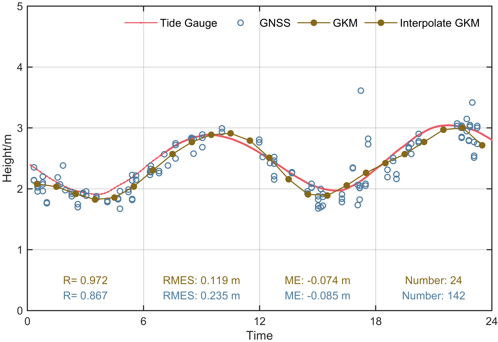

# MATLAB | Data Fitting Algorithm | Gaussian Kernel Model L2 Constraints Minimization Least Squares Learning | Included data and plotting code | Directly Implementable

\n        \n  
\n        \n          \n          \n          \n          \n            To view this video please enable JavaScript, and consider upgrading to a\n            web browser that\n            supports HTML5 video\n  

## Images

<!-- PAYMENT_BLOCK -->

## Get this dataset

- Payment link (Stripe): [Buy now](https://buy.stripe.com/3cs8yP7sY87d0vu9AB)
- Payment QR code: 

<!-- /PAYMENT_BLOCK -->
